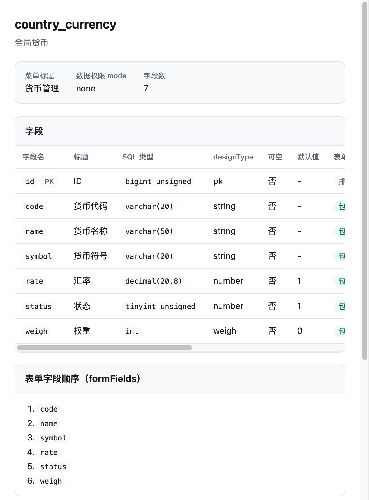
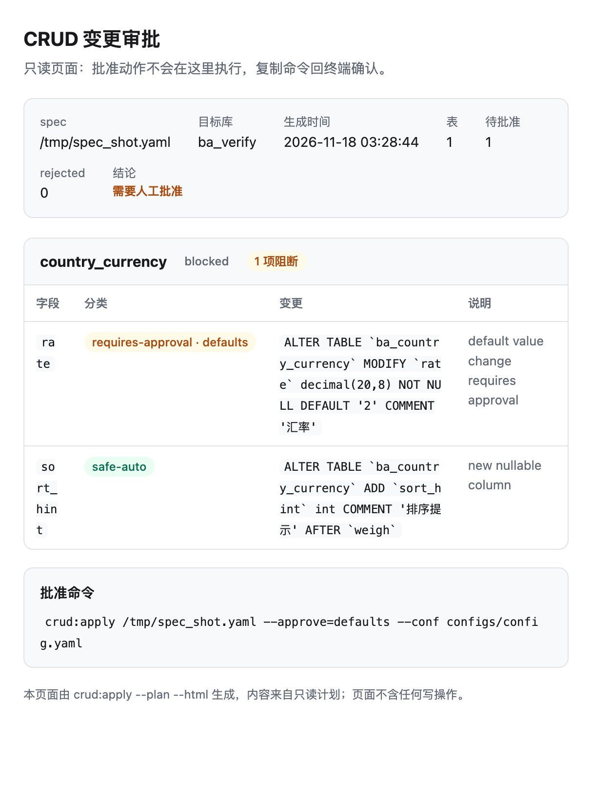

# 文档入口

按任务选入口，不要从头读。仓库根 `AGENTS.md` 是协作规则速查，本目录是专项文档。

## 我要做的事

| 任务 | 读这个 |
| --- | --- |
| 第一次跑起来 / 安装 / 升级框架 | [`framework-workflow.md`](framework-workflow.md) |
| 加一张业务表、改字段、配数据权限 | [`crud-cheatsheet.md`](crud-cheatsheet.md)（动线）→ [`crud-generation.md`](crud-generation.md)（契约） |
| 写 repo / service / handler | [`business-development.md`](business-development.md) |
| 改前端组件、表格/表单、语言、门户接入 | [`framework-web.md`](framework-web.md)（web 端唯一权威） |
| 部署镜像 / compose / 端口变量 | [`docker-compose.md`](docker-compose.md) |
| 扩展业务迁移轨道 | [`../internal/migrations/business/README.md`](../internal/migrations/business/README.md) |
| 改框架自身（发布、迁移轨道、PHP 上游同步） | [`framework-maintenance.md`](framework-maintenance.md) |
| 业务文档模块（`public/docs/`） | [`../public/docs/guide.html`](../public/docs/guide.html) |
| 看这一轮改进项与未做项 | [`improvement-backlog.md`](improvement-backlog.md) |

## 常用命令（最短路径）

```bash
# 安装
go run ./cmd/server setup

# 新建业务模块（校验 + 差量预检 + 生成 + wire/build）
go run ./cmd/server crud:new ops_demo --comment 演示
go run ./cmd/server --conf configs/config.yaml crud:up crud_specs/ops_demo.yaml

# 看状态
crud:list [--drift] / crud:diff <spec> / migrate status / diagnose

# 发版前
migrate --plan
```

## 界面预览

| 登录 | CRUD 预览（`crud:preview`） | 变更审批（`crud:apply --plan --html`） |
| --- | --- | --- |
|  |  |  |

后两张是**只读**页面：预览用来在生成前检查字段与组件选择；审批页按 `safe-auto` / `requires-approval` / `rejected` 分类展示差量，并给出可复制的 `--approve=` 命令，页面本身不执行任何写操作。
